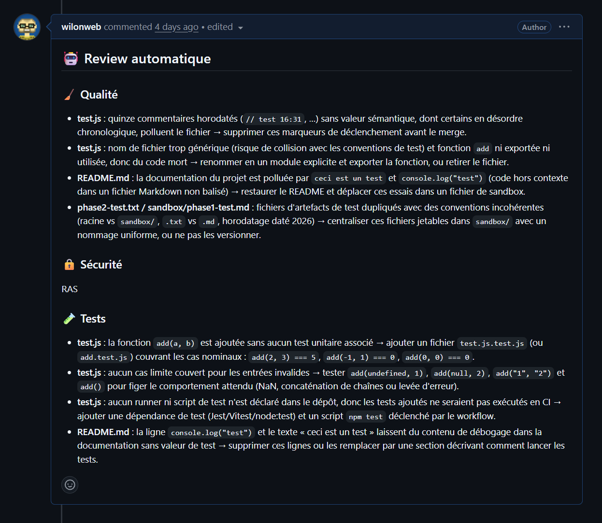
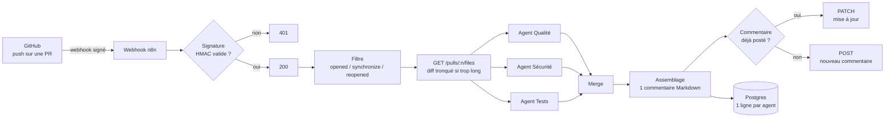

# n8n-claude-pr-reviewer

Un agent qui relit automatiquement les Pull Requests GitHub. À chaque push sur une PR, **trois agents Claude spécialisés** (qualité, sécurité, tests) analysent le diff. Leurs retours sont réunis dans **un seul commentaire** sur la PR, et chaque review est enregistrée dans Postgres pour suivre ce qu'elle coûte.

Tout est construit avec **n8n**, sans framework d'agents : un webhook, du JavaScript et des appels HTTP.

Le découpage en agents s'inspire de deux livres gratuits sur la code review :

- [*What to Look for in a Code Review*](https://leanpub.com/whattolookforinacodereview) (Trisha Gee, JetBrains) : une bonne review regarde plusieurs axes distincts (qualité, tests, sécurité…), et chaque équipe choisit ceux qui comptent pour elle. Ici, chaque axe a son agent spécialisé, avec ses propres consignes, et ignore volontairement le travail des autres.
- *Best Kept Secrets of Peer Code Review* (Jason Cohen, SmartBear) : d'après les études qu'il rassemble, la plupart des défauts sont trouvés par des relecteurs qui travaillent **chacun de leur côté**, et une review perd en efficacité au-delà de quelques centaines de lignes. D'où des agents indépendants, et un diff tronqué.

*Exemple réel : deux agents relèvent des points, l'agent Sécurité répond « RAS » — il n'invente pas de problème quand il n'y en a pas.*

## Comment ça marche

1. **Sécurité du webhook** : GitHub signe chaque requête avec un secret partagé. Le nœud Code recalcule la signature HMAC-SHA256 sur le corps brut de la requête, puis la compare en temps constant. Une requête non signée reçoit un 401 avant tout appel à l'IA, donc elle ne coûte rien.
2. **Récupération du diff** : appel à l'API GitHub `pulls/:n/files`. Le diff est tronqué à 3 000 caractères par fichier et 20 000 au total, pour garder un coût maîtrisé, et l'agent est prévenu quand c'est le cas.
3. **Trois agents en parallèle** : chacun a un prompt centré sur sa spécialité (voir [`prompts/`](prompts/)), avec une consigne « ignore le reste, d'autres agents s'en occupent ». Format imposé : 4 points maximum, ou « RAS » s'il n'y a rien à signaler.
4. **Un seul commentaire, mis à jour** : le commentaire contient un marqueur invisible (`<!-- pr-review-bot -->`). À chaque nouveau push, le workflow cherche ce marqueur et met à jour le commentaire existant au lieu d'en ajouter un.
5. **Journal des reviews** : une ligne par agent dans Postgres (tokens en entrée et en sortie). On peut ainsi savoir quel agent coûte le plus cher et combien coûte chaque PR (voir [`sql/stats.sql`](sql/stats.sql)).

## Chiffres réels

Mesurés sur une PR de test de 4 fichiers, avec le modèle `claude-opus-5` :

| Agent | Tokens en entrée | Tokens en sortie | Coût |
|---|---|---|---|
| Qualité | 685 | 596 | 0,018 $ |
| Sécurité | 725 | 5 (« RAS ») | 0,004 $ |
| Tests | 734 | 569 | 0,018 $ |
| **Total par review** | | | **≈ 0,04 $**, en ~20-25 s |

Le travail sur les prompts a réduit les tokens de sortie de 67 % (de commentaires bavards à 4 points maximum par agent).

## Stack

- **n8n** (auto-hébergé, Docker) : orchestration
- **Claude** (API Anthropic, nœud natif n8n) : les 3 agents
- **API REST GitHub** : diff et commentaires
- **PostgreSQL 16** (Docker, réseau interne, non exposé à Internet) : journal des reviews
- VPS Linux et reverse proxy nginx en HTTPS

## Choix et limites

- **Commentaire global plutôt que commentaires ligne par ligne** : plus simple et plus robuste. Commenter une ligne précise (`pulls/:n/comments`) demande `commit_id`, `path` et `line`, et casse dès que le diff bouge.
- **Le bot poste avec mon compte** : GitHub interdit d'« approuver » sa propre PR, donc l'agent commente sans donner de verdict. Un compte bot ou une GitHub App lèverait cette limite.
- **n8n exécute les 3 branches l'une après l'autre**, pas vraiment en parallèle : la durée totale est la somme des trois.
- **Chaque push déclenche une review payante** : il n'y a pas encore de filtre sur la taille du diff ni de bouton pour désactiver la review.
- **Les erreurs ne sont pas journalisées** : seules les reviews réussies arrivent en base.
- **Les agents ne voient que le diff** : ils ne savent pas où le code modifié est utilisé ailleurs dans le repo, ni s'il s'intègre bien dans l'architecture globale.

## L'installer chez soi

1. Importer [`workflow/pr-reviewer.json`](workflow/pr-reviewer.json) dans n8n.
2. Créer et sélectionner 3 credentials : GitHub (token avec accès aux PR), Anthropic, Postgres.
3. Créer la table avec [`sql/init.sql`](sql/init.sql).
4. Donner à n8n les variables d'environnement `GITHUB_WEBHOOK_SECRET` et `NODE_FUNCTION_ALLOW_BUILTIN=crypto`.
5. Sur le repo GitHub : Settings → Webhooks → URL du webhook n8n, type `application/json`, même secret, événement *Pull requests*.

## Pistes

- Compte bot ou GitHub App, pour pouvoir donner un vrai verdict (approve / request changes)
- Réduire la réflexion du modèle (coût et durée), ou utiliser un modèle plus léger pour l'agent Sécurité
- Ignorer les PR trop grosses ou les fichiers générés
- Journaliser aussi les échecs
- Configuration par projet : choisir les prompts et le modèle selon le repo (un fichier `.pr-reviewer.yml` lu dans le repo, ou une table de config dans Postgres). Exemples : critères adaptés au langage ou au framework, modèle léger pour les petits repos, agents activés ou non
- Donner aux agents la **description de la PR** (pas seulement son titre), pour vérifier que le code fait ce qu'elle annonce
- Un **niveau de gravité** sur chaque remarque (🔴 bloquant / 🟡 à discuter / 💡 suggestion)
- Laisser le formatage et le style à un linter, pour concentrer le LLM sur ce qu'un outil ne sait pas faire
- Enrichir les consignes : nouvelles dépendances, routes sans authentification, branches non testées, code mort ou de debug, requêtes en boucle
- Fournir aux agents les fichiers complets autour du diff, pour juger l'impact du changement
- Signaler les PR trop grosses (au-delà de ~400 lignes modifiées) et conseiller de les découper, plutôt que de les relire mal
- Un agent « modérateur » après les 3 autres, pour supprimer les doublons et écarter les faux positifs
- À chaque nouveau push, indiquer quelles remarques de la review précédente ont été corrigées
- Enregistrer chaque remarque avec son type et sa gravité, pour voir dans Postgres les problèmes les plus fréquents et faire évoluer les consignes

## Contexte

Projet d'apprentissage mené par phases (webhook → HMAC → diff → 1 agent → 3 agents → logs), chacune avec un mini-RFC écrit avant de coder et un bilan après. L'agent **Tests** est celui qui m'a le plus appris : il ne vérifie pas si le code marche, il repère le code ajouté sans test et propose des cas limites à couvrir.
